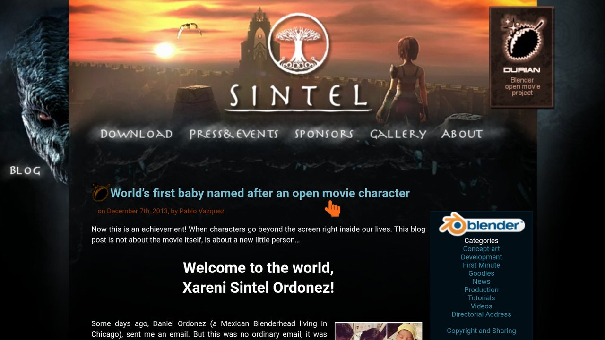
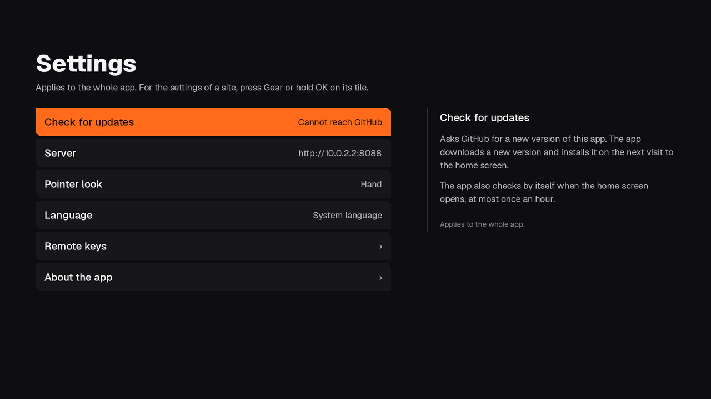
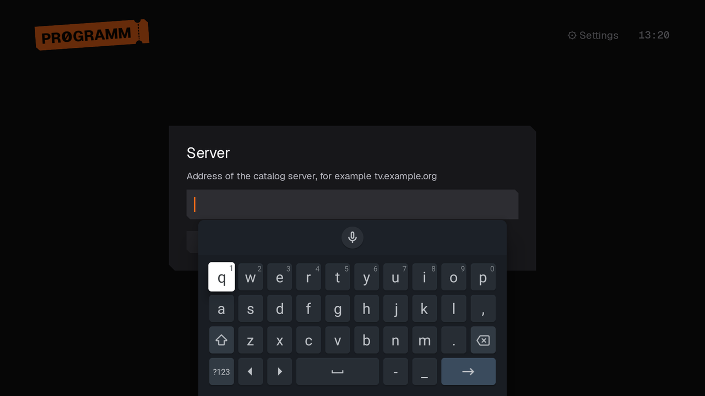

  

<h1 align="center">pr0gramm</h1>

  Open your sites full screen on Android TV, with a remote-control pointer.

  
  
  
  

  <a href="#install">Install</a> ·
  <a href="#catalog-and-server">Catalog</a> ·
  <a href="docs/">Documentation</a> ·
  <a href="CONTRIBUTING.md">Contributing</a>

  

---

The app opens your sites in a full-screen WebView. You control it with the TV remote. The app shows the sites
and installable apps from a catalog. You choose the server that hosts the catalog.

## Features

- Full-screen WebView for each site
- Remote-control pointer and video fullscreen
- Settings for each site
- A saved list ("Meine Liste")
- Catalog on any static file server. A catalog change needs no app release.
- Self-update from the GitHub Releases of this repo

**Planned:** a "Watched" list ("Angeschaut") for films and videos that you watched to the end, and an ambient
mode. The app does not have these features yet. See [docs/roadmap.md](docs/roadmap.md).

## Screenshots

<table>
  <tr>
    <td></td>
    <td></td>
  </tr>
  <tr>
    <td align="center">A site with the pointer</td>
    <td align="center">Settings</td>
  </tr>
  <tr>
    <td></td>
    <td></td>
  </tr>
  <tr>
    <td align="center">Server dialog on the first start</td>
    <td align="center">Remote keys</td>
  </tr>
</table>

The screenshots use a demo catalog with open movies of the Blender Foundation. The sources are in
[docs/assets/screenshots/CREDITS.md](docs/assets/screenshots/CREDITS.md).

## Install

Requires Android TV 13 (API 33) or later.

1. Download `pr0gramm-tv.apk` from the [latest release](https://github.com/pr0gramm-dev/pr0gramm-tv/releases/latest).
2. Install the APK on the TV. For example, run `adb install pr0gramm-tv.apk`.
3. Start pr0gramm. Enter the address of your catalog in the server dialog.

The app updates itself after this first install.

## Catalog and server

The app contains no server address. You enter the address on the first start.

- The catalog is a file named `manifest.json` on a static file server.
- The server needs no login.
- The complete rules are in [docs/server-and-updates.md](docs/server-and-updates.md).
- A complete example is in [`example/`](example/README.md).

## Documentation

| Topic | File |
|---|---|
| Catalog, server, self-update | [docs/server-and-updates.md](docs/server-and-updates.md) |
| Remote control, ads, test page | [docs/features.md](docs/features.md) |
| Build, configuration, development | [docs/development.md](docs/development.md) |
| Release process | [docs/release.md](docs/release.md) |
| Planned features | [docs/roadmap.md](docs/roadmap.md) |
| Architecture | [docs/architecture.md](docs/architecture.md) |
| Privacy | [PRIVACY.md](PRIVACY.md) |

## Contributing

Read [CONTRIBUTING.md](CONTRIBUTING.md) before you open a pull request. To report a security problem, read
[SECURITY.md](SECURITY.md). Do not open a public issue for it.

## License

MIT. See [LICENSE](LICENSE).
