# Architecture: pr0gramm

The structure follows [arc42](https://arc42.org). The views follow [C4](https://c4model.com). This document
describes the code at the commit that last changed it. Section 12 defines the terms.

## 1. Introduction and goals

pr0gramm is one Android TV app for a family in several households. The TV shows it as "pr0gramm" (app id
`dev.pr0gramm.tv`). The app is a launcher in the TV's app list (`LEANBACK_LAUNCHER`), not the system home screen.

The start page shows sites and installable apps as tiles. The app opens a site full screen in a WebView. There, the
user moves a pointer with the remote control. The app remembers favourites, "Meine Liste" and "Weiterschauen".

Sites and apps come from the manifest on a static file server. The user types the server address on the TV (server
dialog). The app shows its texts in English or German (section 8, Localisation). The app updates itself from the
GitHub Releases of the repo `pr0gramm-dev/pr0gramm-tv` (self-update). App, catalog and
server change independently.

| Priority | Quality goal | Meaning |
|---|---|---|
| 1 | Smooth | Start page on the TCL TV: ≤ 5 % janky frames, median ≤ 16.7 ms (section 10). Fluid beats fancy. |
| 2 | Hard to get wrong | Arrows, OK, hold OK, Back and the Gear key. No filter chips, no hidden states. One focus colour. |
| 3 | Changed without a release | Sites and apps come from the manifest; the app takes a new one without a restart. |
| 4 | Safe updates | Every build accepts an http or https server address; the user chooses which server address to trust. APKs of the catalog come from the URL that the manifest names. Over http, `size` and `sha256` find a broken download, but not a swap in the network. Android's signature check protects the update of an installed app. The first install of a catalog app over http stays open to a swap in the network. The owner accepts this risk: a signed manifest does not help, because the key comes from the same server. The protection is an https server address; it needs no new app build. The self-update comes only from GitHub Releases. The app checks size and SHA-256 of every APK. The release key lives in the owner's secret store and in the secret `RELEASE_SIGNING_KEY` of the environment `release` (tags `v*` only). |

## 2. Constraints

- Android TV: minSdk 33, targetSdk 34, compileSdk 37. The TVs are a Google TV Streamer and a TCL, both with
  Android 14 (Owner, 2026-11-19). The user has only the remote control.
- Kotlin, Compose for TV (`tv-material`), DataStore, Coil 3. Manual dependency injection (`AppContainer`). Tests use
  fakes, no mocks and no Robolectric.
- The Gradle plugin `pr0gramm.quality` checks only the module `app`. In that module, every
  `.kt`, `.kts` and `.js` file has at most 300 lines (Gradle task `sourceRules`). In `app/src/main/kotlin`, no
  string literal holds German text (`sourceRules`, section 8). detekt with formatting is
  clean. Every Kotlin suppression annotation carries a `// reason:` comment. The plugin does not check
  `build-logic`.
- The server is any static file server that an operator chooses: no logic, no login, no admin UI. This repo holds
  no server and no server image.
- The repo is public (`pr0gramm-dev/pr0gramm-tv`). It holds the app, the example catalog in `example/` and the
  release pipeline. It holds no private catalog: `tests/privacy-test.sh` searches the tracked files for private
  names.
- APKs never go into git. `.gitignore` lists `*.apk`, `local.json`, `blocklist.txt` and `banners/`. `local.json`
  holds only the keys `adb` and `blocklist`.
- The owner approves every UI as an HTML mock first. The mocks are in the owner's local spec folder, not in this
  repo.
- First install: the user downloads
  `https://github.com/pr0gramm-dev/pr0gramm-tv/releases/latest/download/pr0gramm-tv.apk` and installs it, for
  example with `adb install`. Every later version comes through the self-update. Contributors without the release
  key install a debug build with `./gradlew installDebug`.
- mise installs Java 17 (`temurin-17`) and the Android command-line tools (`mise.toml`). The owner installs adb,
  platform 37 and build-tools 37 once with `sdkmanager`. mise puts them on the PATH.

## 3. Context (C4 level 1)

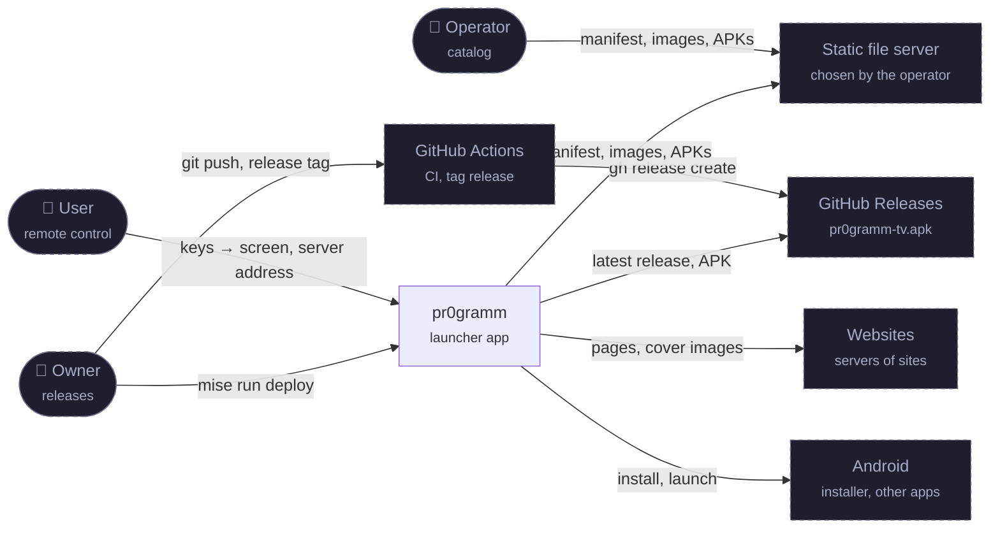

dashed: outside

- The box `pr0gramm` is the whole system: the app `dev.pr0gramm.tv` on the TV.
- The operator puts the catalog on the server. Nothing in this repo uploads to a server. `example/` shows a
  catalog.
- `mise run deploy` installs the app over adb, without the server and without GitHub Releases.

| Partner | Interface |
|---|---|
| User | Remote control: arrows, OK, hold OK (600 ms), Back and the Gear key. In the browser, Back held for 600 ms closes the browser at once (`KeyRouter`). |
| Owner | Pushes a git tag `vMAJOR.MINOR.PATCH`, which starts the release. `mise run deploy` installs the app over adb. |
| Operator | Puts `manifest.json` and the files it names on a static file server (`example/README.md` has the format). `mise run check-manifest <file> [--apks]` checks a manifest with the parser of the app. |
| GitHub Actions | `.github/workflows/release-please.yml` keeps a release PR on `main`; its merge creates the tag and a draft release. `.github/workflows/release.yml` runs for a tag `v*`, one run at a time. It builds and signs the APK and publishes the GitHub Release of the tag with the one asset `pr0gramm-tv.apk` (section 7). `.github/workflows/ci.yml` runs `mise run test` on every push and every pull request. |
| GitHub Releases | The app sends `GET https://api.github.com/repos/<UPDATE_REPO>/releases/latest` without a token (`GithubReleases`). `BuildConfig.UPDATE_REPO` comes from `-PupdateRepo`, default `pr0gramm-dev/pr0gramm-tv`. The download of `pr0gramm-tv.apk` follows https redirects only to `github.com` and `*.githubusercontent.com`, at most 5 (`Http.follow`). `SelfUpdateCheck` asks at most once per hour; "Nach Updates suchen" asks at once. Without a token GitHub allows 60 requests per hour and IP address. |
| Static file server | The app sends `GET` for `<server address>/manifest.json`. It also sends `GET` for the images and APKs that the manifest names. It resolves a relative path relative to the manifest, and it uses an absolute http(s) URL as it is. Every build accepts an http or https server address. The app checks no origin. It sends no token and follows at most 5 redirects to any http or https target (`Http.follow`). It reads the manifest up to 2 MiB and an image up to 5 MiB. `CatalogSync` asks at most once per hour. A check that the user starts asks at once. |
| Websites | The system WebView loads the pages of a site, with zoom, user agent and blocklist from the app. Requests look like Chrome on Android, or like desktop Chrome on Linux when the site uses the desktop layout (`UserAgent.kt`). `CoverDownloader` loads the cover image of a saved page with the Chrome user agent for Android (`CoverSource.kt`). |
| Android | `<queries>` for the categories `LEANBACK_LAUNCHER` and `LAUNCHER` (installed state). PackageInstaller installs apps and the self-update. `LauncherActivity` starts other apps with launch intents from `PackageManager`. |

## 4. Solution strategy

- **One catalog format.** The manifest describes sites and apps, not the app itself (`Manifest.OWN_PACKAGE` in
  `apps` is a parser problem). The app embeds no catalog. At run time, `CatalogSync` replaces the current catalog
  with the newest valid manifest from the server, without a restart.
- **Server address on the TV.** The app contains no server address. `ServerSetup` saves the server address that the
  user types only after its server sent a valid manifest. The process reads the saved server address once at start.
  A new server address restarts the process (`ProcessRestart`). The data of each server lives in its own folder
  `servers/<key>/`.
- **Self-update apart from the catalog.** `SelfUpdate` reads the latest GitHub release and needs no server address.
  `CatalogSync.check` and `SelfUpdate.check` run apart, so a failure of one does not stop the other.
- **Validate once.** One pure-Kotlin parser in `data.manifest` serves the app and `build-logic` (`checkManifest`).
  A manifest that is not valid stops the build or CI. On the TV, `CatalogSync` ignores a manifest that is not valid
  and keeps the last valid one.
- **Keep user data.** When a site leaves the manifest, the app hides its settings and its entries but keeps them.
  They come back with the site. One exception: a shelf holds at most 50 entries. When a new entry goes over that
  limit, `SavedList.add` removes the oldest hidden entries first.
- **Layers and domain events.** The code has five layers: `app` > `ui` > `domain` > `data` > `core` (section 5).
  `domain` holds the rules, and `data` only stores and loads. Slices of one layer talk to each other only through
  domain events, and only `EventRoutes` in `app` routes them. The Gradle task `packageGraph` checks the layers in
  `check`.
- **Rules without Android.** These parts take values and return values: `Home`, `HomeBlocks`, `TileText`,
  `SavedList`, `InstallQueue`, `SyncPolicy`, `SelfInstallState`, `decide()`, `SettingsForm`, `General`,
  `Navigation`, `PageMeta`, `ServerAddress.parse`, `AppVersion`, `ServerDialog.reason`. A text for the user leaves
  them as a `UiText`, not as a `String` (section 8). `KeyRouter` and `OkPress` keep state, but they get the clock as a parameter. JVM unit
  tests cover all of them. Android (WebView, DataStore files, PackageInstaller, network) sits at the edges behind
  small interfaces, for example `PackageInstallerPort`, `Http` and `CoverSource`.
- **State as `StateFlow`.** Three ViewModels hold the state of their screens: `LauncherViewModel`,
  `BrowserViewModel` and `SettingsViewModel`. `LauncherViewModel` exposes the start page as `state` and the saved
  pages for the tile menu as `saved`. For `state`, it follows the catalog with `flatMapLatest`. Two `combine` calls
  join the stores, the installed versions and the install queue. The pure `Home.build` then makes the rows. The
  general settings page has no ViewModel: `LauncherActivity` reads `SelfUpdate`, `CatalogSync`, `ServerSetup` and
  `AppSettings` from `AppContainer` for it.
- **Cheap UI.** Design system "Nacht" (`Night` in the code): near-black surfaces, orange only for focus, cut
  corners, Geist font. Focus changes colours only: no scale, no crossfade, no blur, no hero, no backdrop. Tiles
  paint their cut corners and do not clip (section 8). Other elements still clip to `cutShape`, for example the
  panel rows and the gear.
- **One install queue.** App installs and the self-update run one at a time. The self-update installs only while
  the start page is in front.

## 5. Building blocks

### Containers (C4 level 2)

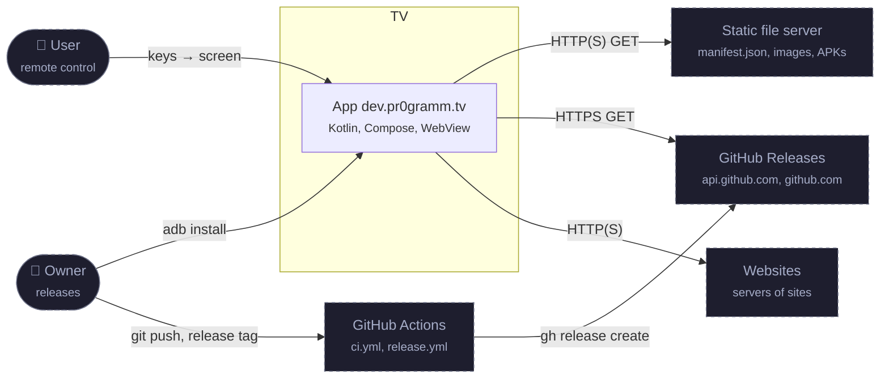

dashed: outside

- The app sends `GET` over HTTP or HTTPS for the manifest, the images and the APKs of the catalog. Every build
  accepts an http or https server address. An image or APK with an absolute URL comes from another server, for
  example a GitHub Release.
- The operator chooses and runs the static file server. This repo holds no server.
- The app sends `GET` over HTTPS to the GitHub API for the latest release and loads `pr0gramm-tv.apk` from
  `github.com`.
- `.github/workflows/release.yml` creates the GitHub Release with `gh release create`.
- `mise run deploy` installs the app with `adb install` over TCP.
- The WebView loads the pages of a site from its website over HTTP or HTTPS.

### Level 1: layers of the app (C4 level 3)

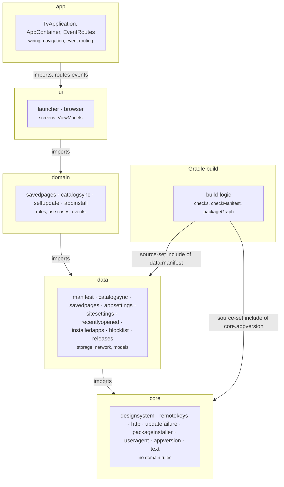

Legend: no dashed box, because every box is in this repo.

- An arrow points to the next lower layer. A layer can import every lower layer, not only the next one. For example,
  `ui.browser` imports `data.savedpages` and `core.designsystem`. The diagram does not show these edges.
- `AppContainer` in `app` creates the parts of every slice and connects their events (section "Domain events"
  below). `TvApplication` creates the one `AppContainer` and calls `AppContainer.start`.
- `build-logic` imports nothing from the app. Its Gradle file adds the folders of `data.manifest` and
  `core.appversion` as source folders (`build-logic/build.gradle.kts`). `app/build.gradle.kts` sets `versionCode`
  and `versionName` with `AppVersion`.
- `LauncherActivity` in `app` starts other apps without `domain.appinstall`: `LauncherActivity.launch(pkg)` gets
  the launch intent from `PackageManager`.

### Layers, slices and segments

The packages of the app follow the layers of
[Feature-Sliced Design](https://feature-sliced.design/docs/reference/layers), with the layer names of the Android
architecture guide. The task `packageGraph` (`PackageGraph` in `build-logic`) checks every file of
`app/src/main/kotlin` against the table below. `./gradlew check` runs `packageGraph`. `PackageGraph.TABLE` is the
only source of the table: the test `PackageGraphDocsTest` fails when this table lists other packages or another
order.

The layers, top to bottom: `app` > `ui` > `domain` > `data` > `core`. A layer of slices (`ui`, `domain`, `data`)
holds one package per slice. `app` and `core` have no slices: `app` is one package, `core` has segments without
domain rules. A name with two parts below the layer is a segment of a slice: `ui.launcher.settings` belongs to
the slice `ui.launcher`.

The rules of the app live in `domain` (Domain-Driven Design). A `domain` slice exists only
where the app has rules. `data` only stores and loads: DataStore, files, network and serialization.

`packageGraph` fails on each of these problems. Each message names the file, the line and the rule.

- A reference to a higher layer.
- A reference to another slice of the same layer in `ui`, `domain` or `data`. Every `data` slice can use
  `data.manifest`. The segments of `app` and of `core` can reference each other.
- A cycle between segments of `core`. The message names the cycle.
- A file in a package that the table does not list, or a file whose directory does not match its `package`. Only
  `BuildConfig` and `R` are in the root package `dev.pr0gramm.tv`. Every package except `data.manifest` and
  `core.appversion` can use them.
- An import of `android.*` or `androidx.*` in `domain`.
- An import of `dev.pr0gramm.tv.*`, `android.*` or `androidx.*` in `data.manifest` or `core.appversion`, other than
  the package itself. These packages stay pure Kotlin, because `build-logic` compiles them.

A reference is an import or a fully qualified name in the code. Comments (also nested comments and KDoc), string
literals and char literals do not count. Code in `${}` counts.

These rules apply to imports and names. `import … as X` counts by its path.
`import dev.pr0gramm.tv.<layer>.<slice>.*` counts by its slice. `import dev.pr0gramm.tv.<layer>.*` without a slice
is an error. Every other `dev.pr0gramm.tv.<x>` without a known layer is an error too.

| Package | Responsibility | Main parts |
|---|---|---|
| `dev.pr0gramm.tv.app` | Wiring (`AppContainer`), the event routes between slices (`EventRoutes`), navigation, the activities, `TvApplication` and the process restart after a new server address (`ProcessRestart`). | `TvApplication`, `AppContainer`, `EventRoutes`, `ProcessRestart`, `LauncherActivity`, `LauncherScreen`, `BrowserActivity` |
| `dev.pr0gramm.tv.ui.launcher` | Start page: header, then the blocks Weiterschauen, Meine Liste, Seiten, Apps. Tile menu: a site also lists its saved pages (`SavedSections`); an app with an update shows the badge and "Aktualisieren" first. The notice without a catalog (`NoCatalog`) and the server dialog (`ServerDialog`) with the manifest problem in the app language (`ProblemText`). Sends E6. | `LauncherViewModel`, `LauncherDependencies`, `LauncherEventSender`, `Home`, `HomeBlocks`, `HomeFocus`, `HomeScreen`, `Tile`, `TileText`, `TileCard`, `TileMenu`, `NoCatalogNotice`, `ServerDialog`, `ProblemText` |
| `dev.pr0gramm.tv.ui.launcher.settings` | Segment of `ui.launcher`: the settings pages. The site settings page, and the general settings page (update check, server, pointer look, language, the key table "Bedienung", "Über die App"). | `SettingsViewModel`, `SettingsScreen`, `SettingsForm`, `General`, `GeneralScreen`, `Controls` |
| `dev.pr0gramm.tv.ui.browser` | Full-screen WebView with a Compose overlay: pointer and focus mode, video keys, popup and redirect guard, page menu, Chrome-like requests. Sends E5 after 10 s of video in full screen (`CONTINUE_WATCHING_AFTER_MS` from `domain.savedpages`). | `BrowserScreen`, `BrowserArgs`, `BrowserDependencies`, `BrowserShelves`, `BrowserEventSender`, `BrowserViewModel`, `KeyRouter`, `Navigation`, `PageMenu`, `SaveMessages` |
| `dev.pr0gramm.tv.domain.savedpages` | Rules of the shelves "Meine Liste" and "Weiterschauen". A shelf holds at most 50 entries (`SavedList.MAX`). "Weiterschauen" keeps the last 5 per site. A page counts there after 10 s of video (`CONTINUE_WATCHING_AFTER_MS`). The slice also holds save, remove and the visit that counts (`Visit`). `SavedShelf` holds the use cases of one shelf; `ShelfView` is its read side. | `SavedShelf`, `ShelfView`, `Shelves`, `SavedList`, `SavedSections`, `DayText`, `Visit` |
| `dev.pr0gramm.tv.domain.catalogsync` | The only writer of the current catalog (`CatalogSync.catalog`). `CatalogSync.check` asks for `manifest.json` at most once per hour. A forced check or a missing catalog asks at once (`SyncPolicy`). The hour counts from the last answer of the server and lives only in memory. It keeps the last valid catalog. `ServerSetup` owns the server address: it saves a typed server address only after a valid manifest. | `CatalogSync`, `SyncPolicy`, `CatalogState`, `SyncResult`, `ServerSetup`, `Connect` |
| `dev.pr0gramm.tv.domain.selfupdate` | Self-update from the latest GitHub release (`GithubReleases`), without a catalog and without a server address. It asks GitHub at most once per hour and decides on the last answer within the hour. Sends E2 and gets E3. It never reads the install queue. | `SelfUpdate`, `SelfUpdateCheck`, `SelfInstallState`, `decide()`, `UpdateStatus` |
| `dev.pr0gramm.tv.domain.appinstall` | The one install queue for apps and the self-update, and its worker. Sends `InstallEvent.Finished` (E1, E3). | `AppInstaller`, `InstallQueue`, `InstallJob`, `InstallEvent` |
| `dev.pr0gramm.tv.data.manifest` | Manifest model (sites and apps; `OWN_PACKAGE` in `apps` is a problem) and its JSON rules. A problem (`ManifestProblem`) names its place in the JSON and the field, for example `sites[0] (nova).zoom`. It also names a kind and the args of the kind. `english()` gives the English line for `check-manifest` and logs. Pure Kotlin, also compiled into `build-logic`. Every `data` slice can use it. | `Manifest`, `ManifestParser`, `ManifestProblem`, `Site`, `CatalogApp`, `Resource`, `ServerPath`, `AbsoluteUrl`, `Json` |
| `dev.pr0gramm.tv.data.catalogsync` | The server address (`ServerAddress`: parse, canonical URL, `key`), its file `filesDir/server-address` (`SavedAddress`) and the folder of each server (`serverDir`: `servers/<key>/` or `servers/none`). Stores the manifest as `catalog/manifest.json` and the images in `catalog/<version>/`, both in the folder of the server. `ServerClient` is the client of the static server at the saved server address: the catalog sync and the install queue load through it. | `ServerAddress`, `SavedAddress`, `serverDir`, `CatalogStorage`, `CachedCatalog`, `ServerClient`, `ServerAnswer`, `IndexEntry` |
| `dev.pr0gramm.tv.data.savedpages` | Stores the saved pages of one shelf and their cover files. `SavedPageStore.update` runs an edit under the lock of the store. | `SavedPageStore`, `SavedPage`, `SavedPageKey`, `Shelf`, `PageMeta`, `CoverDownloader` |
| `dev.pr0gramm.tv.data.appsettings` | Stores the app-wide settings (the pointer's look). Reads and sets the app language in `LocaleManager` (`AppLanguage`); Android stores it, not this slice. | `AppSettings`, `PointerLook`, `AppLanguage`, `LanguageChoice` |
| `dev.pr0gramm.tv.data.sitesettings` | Stores the deviations of each site from the manifest's defaults. | `SiteSettingsStore`, `SiteOverrides` |
| `dev.pr0gramm.tv.data.recentlyopened` | Stores when the start page last opened each site and app. | `RecentlyOpened`, `OpenedKey` |
| `dev.pr0gramm.tv.data.installedapps` | The installed versions of the manifest's apps. | `InstalledApps` |
| `dev.pr0gramm.tv.data.blocklist` | Reads the blocklist from the assets. | `Blocklist` |
| `dev.pr0gramm.tv.data.releases` | Client of the GitHub releases of the repo `BuildConfig.UPDATE_REPO` (`-PupdateRepo`, default `pr0gramm-dev/pr0gramm-tv`), without a token. `latest()` reads the latest release: tag `vMAJOR.MINOR.PATCH` through `AppVersion`, the asset `pr0gramm-tv.apk` with `size` and `digest`. `download()` follows https redirects only to `github.com` and `*.githubusercontent.com`. | `GithubReleases`, `Release`, `ReleaseJson` |
| `dev.pr0gramm.tv.core.designsystem` | Theme "Nacht", cut corners, the menu panel (fixed head, scrolling rows). | `Night`, `Stage`, `PrTheme`, `CutCorners`, `SidePanel`, `PanelRows` |
| `dev.pr0gramm.tv.core.remotekeys` | The keys of the remote control: the one hold rule, OK, menu, the seek step. | `OkPress`, `OK_KEYS`, `MENU_KEY`, `SEEK_S` |
| `dev.pr0gramm.tv.core.http` | HTTP client, its failures, redirects with an allow list (`Http.follow`) and the checked download (size, SHA-256). `VerifiedDownload.save` is the one place of the checked APK download for `ServerClient` and `GithubReleases`. | `Http`, `UrlConnectionHttp`, `HttpFailure`, `follow`, `RedirectRefused`, `VerifiedDownload` |
| `dev.pr0gramm.tv.core.updatefailure` | The failure kinds of an update or a download. | `Failure`, `UpdateFailure` |
| `dev.pr0gramm.tv.core.packageinstaller` | Adapter interface (`PackageInstallerPort`) and Android adapter of the package installer, `InstallReceiver`. | `PackageInstallerPort`, `AndroidPackageInstaller`, `InstallReceiver` |
| `dev.pr0gramm.tv.core.useragent` | The Chrome-like user agent of the requests. | `siteUserAgent`, `IMAGE_ACCEPT` |
| `dev.pr0gramm.tv.core.appversion` | The version `MAJOR.MINOR.PATCH` or `MAJOR.MINOR.PATCH-nightly.N` and its `versionCode` (MAJOR·10 000 + MINOR·100 + PATCH)·1000 + N (MINOR, PATCH ≤ 99; N 1 to 999, 0 for a stable version). Pure Kotlin, also compiled into `build-logic`: the Gradle build and the app use the same rule. | `AppVersion` |
| `dev.pr0gramm.tv.core.text` | The text value `UiText` of every text for the user: a string resource with args, a plain text or a date. Pure code returns a `UiText`; a composable resolves it with `asString`. `resolve` reads `format_locale` for every text; `AppContainer` reads it for `Accept-Language` (AC16). | `UiText`, `text`, `resolve`, `asString` |

### Domain events

Slices of the same layer talk to each other only through domain events. A slice defines its events itself and
publishes them as a `Flow` in its public API. Each sender holds a `Channel(UNLIMITED)` and publishes
`channel.consumeAsFlow()`. So each event arrives exactly once and in order.

An event waits in the buffer until `app`
collects it. The sender never merges or repeats an event. A second collector of the same `Flow` fails.

Only `app` collects events. `EventRoutes` holds every route from an event to the command of another slice, and it
knows no `Context`. `TvApplication.onCreate` calls `AppContainer.start`, and `AppContainer.start` calls
`EventRoutes.start` once. The routes run in the process scope of `AppContainer`, not in the lifecycle of an
activity. A global event bus needs its event types in `core`, the layer without domain rules. Thus the app has no
global event bus.

`app` passes read-only state (`Flow`, `StateFlow`) through constructors. For example, the start page gets
`RecentlyOpened.used`, and the browser gets "Weiterschauen" as a `ShelfView`. A request that waits for an answer is
a port: the asking slice declares the interface, and `app` implements it. The app has no port today: the
self-update needs no catalog. The ids skip one number: there is no event with the id E4.

| Id | Sender | Event | Route in `EventRoutes` | Reaction |
|---|---|---|---|---|
| E1 | `AppInstaller.events` (`domain.appinstall`) | `InstallEvent.Finished(job, outcome)` | `on(InstallEvent)` | `InstalledApps.refresh()` reads the installed versions again. |
| E2 | `SelfUpdate.events` (`domain.selfupdate`) | `SelfUpdateReady(versionCode, apk)` | `on(SelfUpdateReady)` | `AppInstaller.selfReady(versionCode, apk)` puts the checked APK in the install queue. |
| E3 | `AppInstaller.events` (`domain.appinstall`) | `InstallEvent.Finished` with an `InstallJob.Self` | `on(InstallEvent)` | `SelfUpdate.installEnded(versionCode, failed)` updates the status of the self-update. |
| E5 | `BrowserEventSender.events` (`ui.browser`), sent by `BrowserViewModel.WatchRecord` | `VideoWatched(site, page, meta)` | `on(VideoWatched)` | `SavedShelf.save` on "Weiterschauen". A refused page stays out. |
| E6 | `LauncherEventSender.events` (`ui.launcher`), sent by `LauncherViewModel.left` | `OpenedFromHome(key)` | `on(OpenedFromHome)` | `RecentlyOpened.touch(key)` records the use. |

- `AppContainer` owns the one `BrowserEventSender` and the one `LauncherEventSender`, and gives both to `EventRoutes`.
  So an event outlives the screen that sent it.
- `EventRoutesTest` has a test for each event (E1, E2, E3, E5, E6): the sender publishes the event, and the route
  calls the reaction on fakes.

### Level 2: the start page

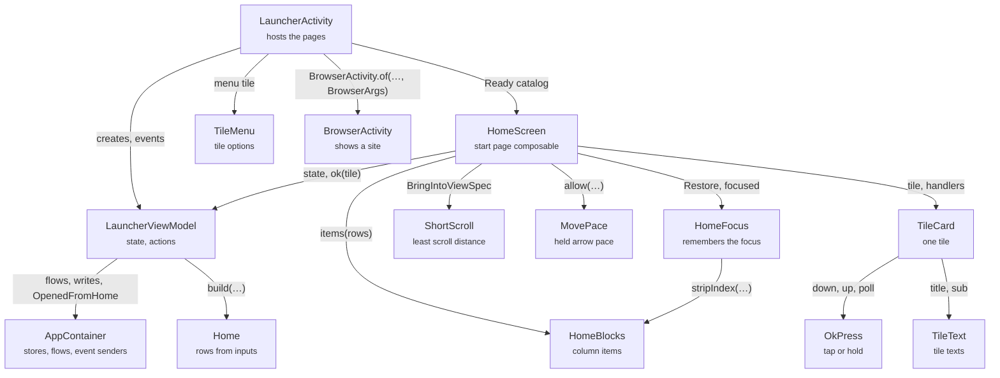

Legend: no dashed box, because every box is in the app.

- `LauncherActivity` creates `LauncherViewModel` with `AppContainer.launcher` (`LauncherDependencies`):
  `CatalogSync.catalog`, `SiteSettingsStore`, `Shelves` (both `SavedShelf` instances), `AppInstaller`,
  the installed versions of `InstalledApps`, `RecentlyOpened.used` and `LauncherEventSender`.
- `LauncherActivity` also hosts the server dialog. Without a saved server address, it opens the dialog by
  itself on the first start. The button "Server eingeben" of the notice without a catalog and the row "Server" of the general
  settings open it too (section 6, "Server address").
- `HomeScreen` gives each `TileCard` its handlers. A focused tile calls `HomeFocus.focused`. A tap calls
  `LauncherViewModel.ok`. A hold or the Gear key calls `LauncherActivity.openMenu`.

`Home.build` turns the catalog and a `HomeInput` into rows. `HomeInput` holds the site options, both shelves, the
installed versions, the install queue and the last use of each site and app. The store `RecentlyOpened` records
that last use: when the start page last opened each site and app. Only E6 writes it. The rows are:

- Weiterschauen: the newest 3 entries of each site.
- Meine Liste.
- Seiten: favourites first, in manifest order. Then the other sites, the last used first. Unused sites follow in
  manifest order.
- Apps: used apps first, the last used first. Then the unused missing apps, then the unused installed apps, both in
  manifest order.

`Home.build` drops empty rows. A site or app counts as used when the start page stops, because the site or app is
in front: `LauncherViewModel.left` then sends `OpenedFromHome` (E6). So the order never changes while the user
sees it. `HomeBlocks` lays out the rows as items of one `LazyColumn`. The header (wordmark, gear, clock) is the
first item and scrolls away with the page. Every block is a title and a `LazyRow` strip.

A `Tile` is a `Tile.Site`, a `Tile.Saved` or a `Tile.App`. A `Tile.Saved` carries its `SavedPage` and `Shelf`. A
`Tile.App` carries its `AppState` (missing, waiting, loading with percent, failed, installed, update). `TileKey`
identifies a tile.

As in the mock `final.html` (not in this repo), a tile is a 360 × 202 frame in stage pixels. The frame holds the picture or a
generated face (name on a colour). For an app, it also holds the state badge and the loading bar.

Below the frame sit the slanted title tag (a star for favourites) and a grey sub line. The sub line shows the site and date of an
entry, or the state or last use of an app. For a site, it shows why the site stands in front ("Favorit",
"zuletzt: gestern"). `TileText` holds these texts.

While a page loads, `Splash` shows the look from `SplashLook`: the banner, or the picture and
title of an entry. The picture is sharp in the middle of a soft, darkened copy of itself. The app decodes the copy
tiny and scales it up, with no blur.

**Focus.** `HomeFocus` alone holds the focus of the start page. It remembers the gear or a tile: the list key of
the tile and its place in its block (`FocusSpot`).

`HomeFocus` survives the tile menu, the settings pages, a site,
another app and a recreated activity. The settings pages keep the saveable state of the start page. A move of the
user only records the new tile.

Android focuses the gear by itself. `HomeFocus` therefore remembers the gear only
after an OK press on it (`pressedGear`). `HomeFocus.Restore` puts the focus back on four events only:

- The start page shows again.
- The tile menu closes.
- The rows change from empty to not empty (the first catalog).
- The remembered tile left its place: the user removed it, or its use moved it to the front.

`HomeFocus.Restore` follows the tile, or takes the tile that is now at its place. It stops after 1000 ms
(`RESTORE_MS`).

**Scrolling.** `ShortScroll` gives Compose's bring-into-view the least scroll distance. It keeps room for the block
title above the tile and the sub line below it. The lazy lists keep only that distance and scroll with Compose's
default spring. The KDoc of `ShortScroll` gives about 200 ms, measured on the TV.

A linear scroll of 150 ms
(`SCROLL_MS`) runs only when `HomeFocus.Restore` brings a moved tile back into view. `HomeScreen` applies
`MovePace` to the page. A held arrow key then moves the focus at most once per 100 ms (`MOVE_GAP_MS`). So a held
key scrolls at a constant pace. A tile in the first block also asks the page to show the header, so one press of
up reaches the gear.

## 6. Runtime view

Six sequence diagrams show the main flows. A participant is a class of the app or Android. A message is a method,
a value or an event of the code. A message with an id (E1, E2, E3, E5, E6) is a domain event of section 5. `alt`
shows a branch. The numbered steps under each diagram give the details.

### Open a page

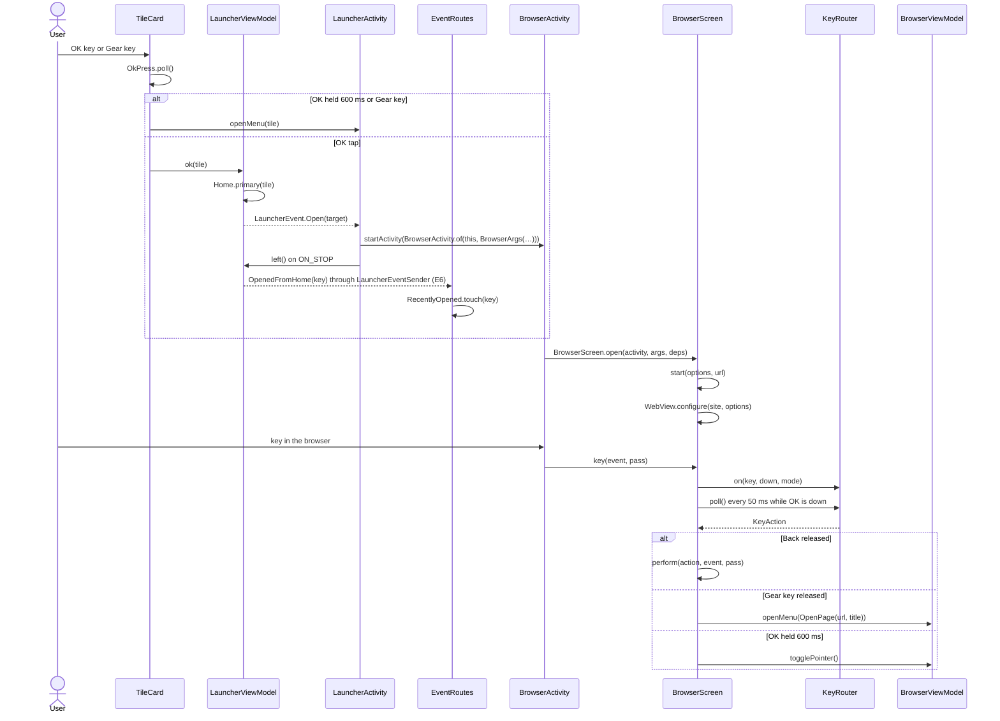

1. On the start page, `OkPress` decides between a tap and a hold. A tap fires on release. A hold fires once at
   600 ms.
2. A hold or the Gear key calls `LauncherActivity.openMenu` and opens the tile menu. The Gear key in the tile menu
   closes the tile menu again.
3. A tap calls `LauncherViewModel.ok`. `Home.primary` gives `Action.Open` for a site or an entry.
4. `LauncherActivity` starts `BrowserActivity` with `BrowserActivity.of(context, BrowserArgs(site, url, title,
   image))`. `BrowserArgs` is the only class that knows the extras of the intent. The URL is null for a site, so the
   site opens at its start URL.
5. The start page stops, because the site or an app is in front. Then `LauncherActivity` calls
   `LauncherViewModel.left`. `left` sends `OpenedFromHome` (E6) to `LauncherEventSender`. `EventRoutes` calls
   `RecentlyOpened.touch`. So the order of the start page never changes while the user sees it.
6. `BrowserActivity` reads `BrowserArgs` from the intent and opens a `BrowserScreen` with `AppContainer.browser`
   (`BrowserDependencies`). An intent without a site, or with a site that the catalog does not know, closes
   `BrowserActivity`. `BrowserActivity` is a thin host: it passes keys and lifecycle calls to `BrowserScreen` in
   their order.
7. `BrowserScreen` reads the site's settings (`SiteOptions`) and calls `BrowserScreen.start`. `start` sets zoom,
   layout and ad block from these settings.
8. `WebView.configure` also allows insecure content when the manifest sets `allowInsecureContent` for the site. It
   sets the Chrome-like user agent (`blendIn`).
9. The `Guard` of the page blocks the domains of the blocklist. The site's `allow` domains stay open.
10. `BrowserActivity.dispatchKeyEvent` gives each key to `BrowserScreen.key`. `BrowserScreen.key` gives the key to
    `KeyRouter.on`. `BrowserScreen.perform` executes the `KeyAction` that `KeyRouter` returns.
11. Back acts on release. It does the first possible action of this list: leave video full screen, close the page
    menu, go back in history, close the page.
12. Back held 600 ms closes the page at once, and the start page shows again.
13. OK held 600 ms switches between pointer mode and focus mode. `SiteSettingsStore` stores the new control for the
    site, and a notice shows it. The switch does not work while the page menu is open.
14. The Gear key opens the page menu on release, and closes it on the next release. The page menu shows "Zu Meine
    Liste hinzufügen" or "Aus Meine Liste entfernen". It also shows "Zu Maus wechseln" or "Zu Fokus wechseln".
15. Below these items, the page menu lists the entries of the site from "Weiterschauen" and "Meine Liste". OK on
    an entry opens it in the same WebView.
16. If the WebView renderer dies, `BrowserHost.rendererGone` shows "Seite abgestürzt" and the page closes. The app
    stays open, and the start page shows again.

### Server address

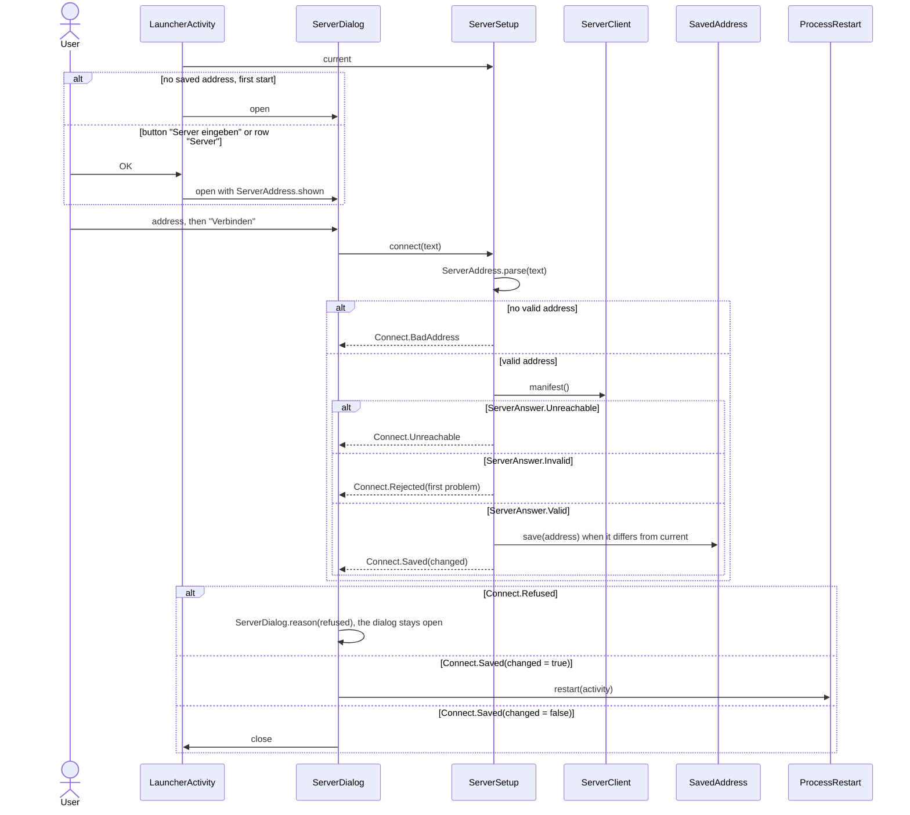

1. `AppContainer` creates `ServerSetup` once per process. `ServerSetup.current` is the server address that
   `SavedAddress.load` reads from the file `filesDir/server-address` at process start. The read is synchronous: the
   file is small.
2. Without a saved server address, `LauncherActivity.onCreate` opens the dialog by itself. Back closes it. The start page
   then shows "Kein Server eingerichtet" with the button "Server eingeben" (`NoCatalogNotice`). The button and the
   row "Server" of the general settings open the dialog again.
3. The dialog has a text field for the TV keyboard and the button "Verbinden". The hint is "Adresse des Katalogs, zum
   Beispiel tv.example.org". The field starts with `ServerAddress.shown` of the current server address.
4. `ServerAddress.parse` adds `https://` to a text without a scheme and appends `/manifest.json` to the path. It
   accepts http and https to any host, in every build. It refuses another scheme, a user, a query and a fragment. The
   canonical URL has a lower-case scheme and host and no default port. Two server addresses are equal when
   their canonical URLs are equal.
5. `ServerSetup.connect` loads the manifest with a `ServerClient` for the new server address. Only a valid
   manifest saves the server address. `SavedAddress.save` writes a temporary file and renames it.
6. A refusal keeps the dialog open. `ServerDialog.reason` gives "Keine gültige Adresse", "Server nicht erreichbar"
   or "Katalog ungültig: <first problem of the parser>". `ProblemText.of` gives the problem (`ManifestProblem`) in
   the app language. A failed write counts as "Server nicht erreichbar".
7. A saved server address that differs from `current` restarts the whole process (`ProcessRestart.restart`).
   `AppContainer` builds the server client and the stores for the server address at process start. Thus the new
   server address takes effect only in the new process.
8. The data of each server lives in `filesDir/servers/<key>/`, where `<key>` is `ServerAddress.key`: the first 16
   hex digits of the SHA-256 of the canonical URL. Without a server address, the folder is `servers/none`.
   Nothing writes to it without a catalog. A change of the server address leaves the old folder. Back at the old
   server address, the app shows the old data.

### Catalog

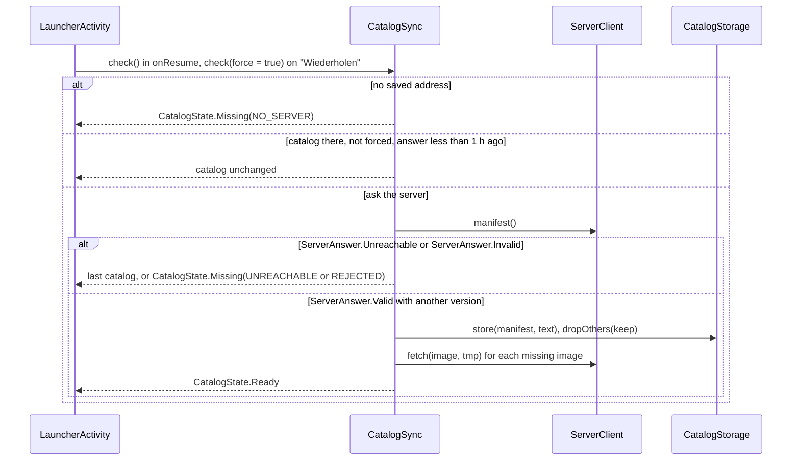

1. `LauncherActivity.onResume` runs each time the start page comes to the front. It calls
   `AppInstaller.foreground(true)`, `InstalledApps.refresh()`, `CatalogSync.check()` and `SelfUpdate.check()`. The
   catalog and the self-update run apart: a failure of one does not stop the other.
2. `CatalogSync.check` starts no second refresh while one runs. It runs the refresh in the process scope of
   `AppContainer`.
3. Without a saved server address, there is no `ServerClient`. The state is `CatalogState.Missing(NO_SERVER)`, and the
   start page shows "Kein Server eingerichtet".
4. `CatalogSync` asks the server at most once per hour (`SyncPolicy`). A forced check or a missing catalog asks at
   once. The hour counts from the last answer of the server and lives only in memory. A restart of the app asks
   again.
5. A forced check comes only from "Wiederholen" on the screen without a catalog. "Nach Updates suchen" in the
   general settings checks only the self-update.
6. A valid manifest with another version applies at once. `CatalogStorage` writes `manifest.json` and deletes the
   folders of other versions.
7. Then `CatalogSync` loads the missing images one by one. Until an image arrives, its tile shows the name.
8. No answer or a manifest that is not valid keeps the last catalog. Without a catalog, the start page names the
   reason and offers "Wiederholen".
9. `ServerClient` follows at most 5 redirects to any http or https target for the manifest, the images and the
   APKs. More redirects or another scheme: the manifest is `ServerAnswer.Unreachable`, an APK is
   `Failure.BAD_INDEX`, and an image stays unloaded until the next sync. An image larger than 5 MiB
   (`MAX_IMAGE_BYTES`) also stays unloaded; `CatalogStorage` deletes its `.tmp` file. `UrlConnectionHttp` waits
   10 s for the connection and 20 s for data.

### Self-update

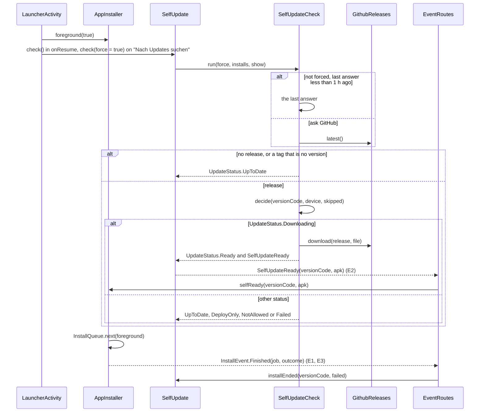

1. `SelfUpdate.check` starts no second check while one runs. It needs no server address and no catalog.
2. `GithubReleases.latest` reads `https://api.github.com/repos/<UPDATE_REPO>/releases/latest` without a token.
   `BuildConfig.UPDATE_REPO` comes from `-PupdateRepo`, default `pr0gramm-dev/pr0gramm-tv`.
3. `AppVersion.parse` reads the tag `vMAJOR.MINOR.PATCH` (MINOR and PATCH at most 99). The `versionCode` is
   (MAJOR·10 000 + MINOR·100 + PATCH)·1000 ([release.md](release.md#version-code)). A tag of another form gives no release, and the status is `UpToDate`.
4. A release without the asset `pr0gramm-tv.apk`, or an asset without `digest`, gives `Failed(BAD_INDEX)`. No
   answer, or an HTTP error such as the rate limit (60 requests per hour and IP address), gives
   `Failed(UNREACHABLE)`.
5. `SelfUpdateCheck` asks GitHub at most once per hour, unless the check is a forced check. Within the hour it runs
   `decide()` again on the last answer, so `NotAllowed` changes at once after the user allows installs. It does not
   keep an `UNREACHABLE` answer: the next check asks again.
6. `decide()` compares the `versionCode` of the release with the installed app. It returns `UpToDate` for the same
   or an older version. It returns `DeployOnly` without the release key and `NotAllowed` without the install
   permission.
7. A version that failed to install before keeps its `Failed` status for every check until a newer version
   appears. `SelfInstallState` knows that version from E3. `FailedUpdateFile` keeps it in `filesDir/self-update-failed`,
   so a restart does not download it again. The settings row then reads "Try the update again" (`general_retry`)
   with the status "Update did not install". OK on it is `GeneralPress.RETRY_UPDATE`: `SelfUpdate.retry()` clears
   the mark and runs a forced check, which downloads the version again. The failure can come from the device and
   not from the version. A successful or cancelled install clears the mark too.
8. `GithubReleases.download` loads the asset and checks its size and SHA-256 against `size` and `digest`
   (`VerifiedDownload.save`). `Http.follow` follows at most 5 https redirects, and only to `github.com` and
   `*.githubusercontent.com`. A redirect to another host gives `BAD_INDEX`.
9. Then `SelfUpdate` sends `SelfUpdateReady` (E2). `EventRoutes` calls `AppInstaller.selfReady`, and the APK goes
   into the install queue.
10. While E2 waits or the install runs, a second check does not download the APK again (`SelfInstallState`).
11. If the APK is broken (`BROKEN_APK`), `SelfUpdateCheck` asks GitHub once more and tries once more.
12. `InstallQueue.next` starts the self-update only when no job runs, no app waits and the start page is in front.
    `LauncherActivity.onPause` calls `AppInstaller.foreground(false)`.
13. When the install of the self-update ends, `AppInstaller` sends `InstallEvent.Finished` (E1, E3). `EventRoutes`
    calls `InstalledApps.refresh()` and `SelfUpdate.installEnded`. The self-update never reads the install queue.

### Install an app

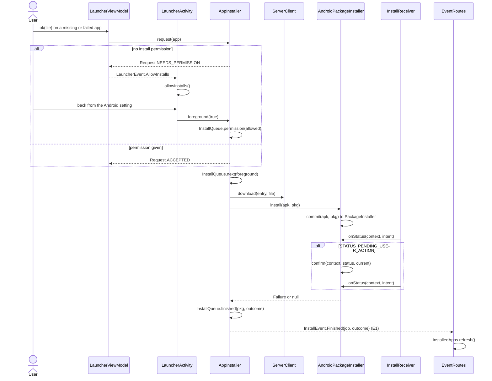

1. OK on a missing app or a failed app calls `AppInstaller.request`. OK on a waiting or loading app does nothing.
2. OK on an installed app or an app with an update starts the app with `LauncherActivity.launch(pkg)`. Only the tile
   menu has "Aktualisieren".
3. Without the install permission, `LauncherActivity.allowInstalls` opens the Android setting for this app. The
   job waits in `InstallQueue.awaitingPermission`.
4. Back on the start page, `AppInstaller.foreground(true)` checks the permission again. With the permission the job
   goes on. Without the permission `InstallQueue` drops the job.
5. The install queue runs one job at a time, the oldest app first. `ServerClient.download` loads the APK from its
   path relative to the manifest or from its absolute URL, and checks its size and SHA-256. Without a saved server
   address, there is no catalog and so no app tile.
6. `AndroidPackageInstaller.install` gives the APK to the PackageInstaller of Android. `InstallReceiver` gets each
   status.
7. When Android asks the user, `AndroidPackageInstaller.confirm` starts the dialog of Android. A cancel there is no
   error. The tile shows "Nicht installiert" again.
8. The tile shows the state of the job: "Wartet …", then "Wird geladen … N %" with the loading bar, then
   "Installiert".
9. After a failure the tile shows "Fehler: Prüfung fehlgeschlagen" and the badge "Fehler". OK on the tile tries the
   install again.
10. At the end of each job, `AppInstaller` sends `InstallEvent.Finished` (E1). `EventRoutes` calls
    `InstalledApps.refresh()` and so updates the installed versions.

### Save a page and Weiterschauen

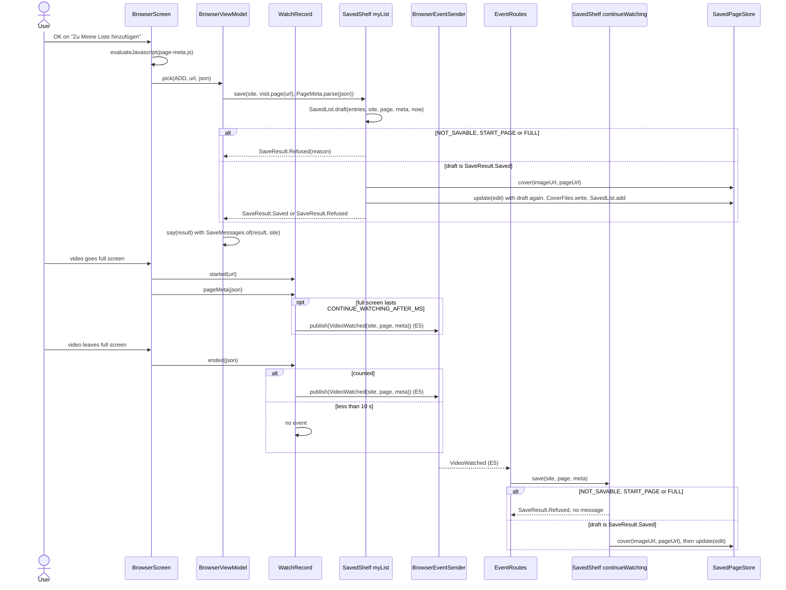

1. "Meine Liste": OK on "Zu Meine Liste hinzufügen" in the page menu calls `BrowserScreen.pick`.
2. `BrowserScreen` runs `page-meta.js` in the WebView and gives the JSON to `BrowserViewModel.pick`. So
   `BrowserViewModel` never holds the WebView.
3. `SavedShelf.save` asks `SavedList.draft` first. `SavedList.draft` refuses a page without a web URL or a video
   that the app plays itself (`NOT_SAVABLE`).
4. `SavedList.draft` also refuses the start URL (`START_PAGE`). It refuses a new page when 50 entries are visible
   (`FULL`, `SavedList.MAX`).
5. For "Meine Liste", `SaveMessages.of` shows the reason of a refusal or the title of the saved entry.
6. `SavedPageStore.cover` loads the cover with `CoverDownloader`: at most 5 MB and 5 s. Only JPEG, PNG and WebP
   count. Any failure gives an entry without a cover.
7. Then `SavedShelf.save` calls `SavedPageStore.update`. Under the lock of the store, the edit drafts again, writes
   the cover file through `CoverFiles` and returns the new list. The store writes the DataStore file once. So of two
   saves at once with 49 entries, the second gets `Refused(FULL)`.
8. "Weiterschauen": when a video goes full screen, `BrowserScreen` calls `WatchRecord.started` and reads the page
   meta for it.
9. After 10 s of full screen (`CONTINUE_WATCHING_AFTER_MS`), `WatchRecord` sends `VideoWatched` (E5) to `BrowserEventSender`. The
   page then counts. `WatchRecord` sends while the video plays, because the screen can close while the video is
   still in full screen (Back held, the Home key).
10. When that full screen ends, `WatchRecord.ended` sends `VideoWatched` again with fresh page meta. The entry moves
    to the front.
11. A full screen of less than 10 s sends nothing.
12. `AppContainer` owns the one `BrowserEventSender`, so an event outlives the screen that sent it. `EventRoutes` collects
    the event in the process scope and calls `SavedShelf.save` on the shelf `CONTINUE_WATCHING`. Each save loads the
    cover as in step 6.
13. A page with the same `SavedPageKey` replaces its old entry. `SavedPageKey` is the site and the normalized URL.
14. The shelf keeps the last 5 entries of each site (`CONTINUE_WATCHING_PER_SITE`). A new entry drops the oldest entry of
    its site.
15. A site with entries never gets `FULL`, because `SavedShelf` does not count the site's own entries.
16. The shelf keeps at most 50 entries (`SavedList.MAX`). On overflow, `SavedList.add` drops the entries of sites
    outside the catalog first.
17. `SavedList.draft` refuses a page with `NOT_SAVABLE`, `START_PAGE` or `FULL` for this shelf too. Then
    `SavedShelf` saves nothing, and the app shows no message.
18. The start page shows the newest 3 entries of each site (`CONTINUE_WATCHING_SHOWN_PER_SITE`).

## 7. Deployment

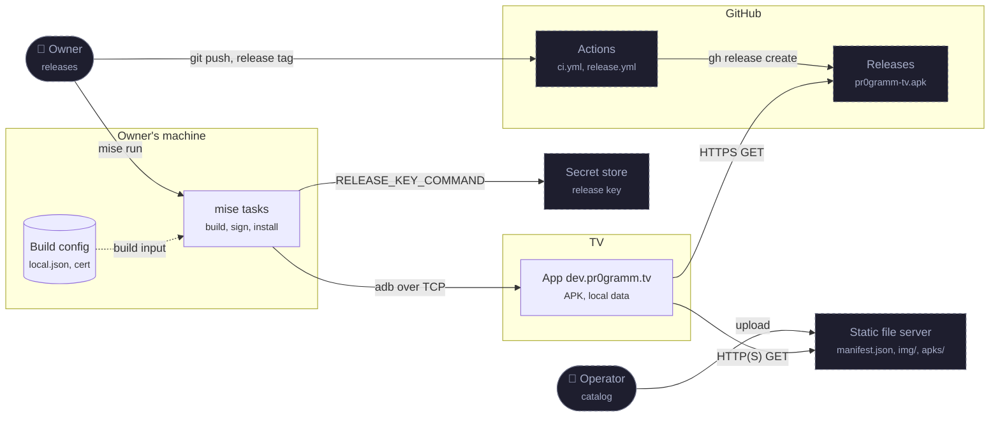

dashed: outside

- The owner's machine runs the tasks in `mise-tasks/` (Owner, 2026-11-19). No task pushes to git or to GitHub
  Releases.
- GitHub Actions runs `mise-tasks/stage` for a tag `vMAJOR.MINOR.PATCH` (`release.yml`). The workflow commits
  nothing.
- Build config: `local.json` (keys `adb` and `blocklist`, git ignores the file), the Gradle properties
  `-PappVersion`, `-PupdateRepo` (`stage` passes `$GITHUB_REPOSITORY`) and `-PreleaseSigned`, and
  `config/release-cert.pem`.
- On the owner's machine, `mise-tasks/sign` reads the release key from the output of `RELEASE_KEY_COMMAND`. This
  command connects a secret store of the owner's choice; `mise.local.toml` sets it, and git ignores that file
  ([release.md](release.md#release-key)). On the runner, `sign` reads the same key from the environment secret
  `RELEASE_SIGNING_KEY`.
- `mise run deploy` connects to the TV over adb on TCP, at the address in the `adb` key of `local.json`.
- The operator chooses the static file server and uploads the catalog to it. The app needs only plain `GET` with
  status 200 (section 3).

| Where | What |
|---|---|
| TV | The APK `dev.pr0gramm.tv`, label "pr0gramm". Under the app's `filesDir`, `server-address` holds the saved server address. `datastore/app-settings.preferences_pb` holds the pointer look. `self-update-failed` holds the failed self-update. `servers/<key>/` holds one folder per server (`servers/none` without a server address). `android:allowBackup="false"`: Android makes no backup of the data. |
| Static file server | `manifest.json` and the files it names with a relative path, relative to it, over http or https. Any server that answers `GET` with status 200. `example/` shows a catalog. |
| GitHub | The public repo `pr0gramm-dev/pr0gramm-tv`. `.github/workflows/ci.yml` runs `mise run test` on every push and pull request. `.github/workflows/release-please.yml` keeps the release PR and, after its merge, creates the tag and a draft release. `.github/workflows/release.yml` makes the tag release. The environment `release` (deployment tags `v*` only) holds the release key as the secret `RELEASE_SIGNING_KEY`; only the job `build` of `release.yml` runs in it. The repo variable `BLOCKLIST_URL` holds the URL of the blocklist. The GitHub Releases hold `pr0gramm-tv.apk` of each version. |
| Owner's machine | Runs `mise run deploy` and `mise run release-key` (Owner, 2026-11-19). The owner merges the release PR, or pushes a release tag from here. |

The tag release (`.github/workflows/release.yml`) starts for a tag `v*`: the push of the tag by the owner, or the
dispatch of `.github/workflows/release-please.yml` after the merge of a release PR. A tag that `GITHUB_TOKEN` creates
starts no workflow; a `workflow_dispatch` does. The tag release runs one release at a time. It has two jobs:

- `build` (`contents: read`, environment `release`) runs `mise-tasks/stage <tag>`.
  - `stage` stops before Gradle unless `mise-tasks/version check <tag>` accepts the tag. The tag must have the
    form `vMAJOR.MINOR.PATCH` (MINOR and PATCH at most 99). It must be greater than every other SemVer tag. The
    tagged commit must be on `origin/main`. It also stops when `HEAD` is not the tagged commit.
  - It downloads the blocklist from `BLOCKLIST_URL` and builds the APK with `-PappVersion=MAJOR.MINOR.PATCH`:
    `versionName` = `MAJOR.MINOR.PATCH`, `versionCode` = (MAJOR·10 000 + MINOR·100 + PATCH)·1000 (`AppVersion`). `sign`
    signs it as `app/build/outputs/apk/release/pr0gramm-tv.apk`.
  - It writes no manifest and no `apks/` folder, and it checks no registry. The job uploads the APK as the artifact `apk`.
- `release` (`contents: write`, no checkout) publishes the GitHub Release of the tag in `$GITHUB_REPOSITORY` with
  exactly one asset, `pr0gramm-tv.apk`. It uploads the APK to the draft release of release-please and then publishes
  it. Without a release of the tag, it creates the release (`gh release create --verify-tag`).

`.github/workflows/ci.yml` runs `mise run test` on every push and every pull request, with `contents: read` only.

The tasks on the owner's machine:

- `mise run deploy` makes a release build with the version of the highest local tag `vMAJOR.MINOR.PATCH` (`0.0.1`
  without a tag) and runs `adb install -r`. Then it runs `cmd package compile -m speed`.
- `mise run check-manifest <file> [--apks]` checks a catalog with the parser of the app (`checkManifest` in
  `build-logic`). Without `--apks` it skips the APKs (`-PskipApks`).

`mise run deploy` checks first that `config/release-cert.pem` exists and that `mise-tasks/sign --check` can read
the release key. `stage` and `deploy` never fall back to the debug key. With
`-PreleaseSigned=true`, Gradle builds an unsigned APK and gets no key: `stage` removes the secrets from the
environment that Gradle inherits. This keeps the key out of build output and logs.

This step does not protect the key from malicious code in a Gradle plugin or dependency. In CI, Gradle runs in the same job as the step that holds the key.
The runner user can read the environment of the processes of that step (`/proc/<pid>/environ`). The runner user can
also replace `apksigner`. Only a separate signing job without Gradle can close that gap.

`mise-tasks/sign` pipes the key from
`RELEASE_SIGNING_KEY` (when set) or from `RELEASE_KEY_COMMAND` into `apksigner sign --key`, and no file holds the key. `sign`
accepts the result only when every signer is `config/release-cert.pem`. `mise run release-key` creates the key and
the certificate once and refuses to replace them. It gives the key to `RELEASE_KEY_STORE_COMMAND` and writes the
certificate only after `RELEASE_KEY_COMMAND` reads the same key back. `mise run deploy` never uninstalls.

A plain `./gradlew assembleRelease` without `-PreleaseSigned=true` signs with the debug key and warns. A
self-update cannot replace such a build. `./gradlew installDebug` installs a debug build for contributors without
the release key; it ends in `DeployOnly` when a newer release exists. Without private files, `check` and the unit
tests run against `local.example.json` and an empty blocklist.

## 8. Cross-cutting concepts

- **Storage.** The stores `SavedPageStore`, `SiteSettingsStore`, `AppSettings` and `RecentlyOpened` each hold one
  DataStore file. A broken file gives an empty or default state, not a crash (`ReplaceFileCorruptionHandler`). The
  catalog is not in DataStore: `CatalogSync` writes plain files through `CatalogStorage`.
  - Per server, the app keeps these files in `filesDir/servers/<key>/` (`serverDir`, `servers/none` without a
    server address). `<key>` is `ServerAddress.key`.
    - `catalog/`: `manifest.json` and the images in `<version>/`.
    - `datastore/my-list.json` and `datastore/continue-watching.json`, with the cover folders `my-list/` and
      `continue-watching/` (`Shelf`).
    - `datastore/recently-opened.preferences_pb`.
    - `datastore/site-settings.preferences_pb`.
  - For all servers, directly in `filesDir`: `server-address` (`SavedAddress`, the canonical URL of the manifest)
    and `datastore/app-settings.preferences_pb` (`AppSettings`, the pointer look). `self-update-failed`
    (`FailedUpdateFile`) holds the versionCode of the self-update whose install failed last. When the file does not
    exist, the app knows no failed version.
    It is a plain file and not a key in `app-settings.preferences_pb` (localisation spec, AC13).
  - A change of the server address leaves the old server folder. The app does not migrate or delete older data directly
    under `filesDir`: no installed copy needs that (spec 2026-11-20).
- **Configuration.** Build time: `-PappVersion` (`MAJOR.MINOR.PATCH`, default `0.0.1`), `-PupdateRepo`
  (`owner/repo`, default `pr0gramm-dev/pr0gramm-tv`), `local.json` and `-PreleaseSigned`. Run time: the server
  address that the user types; every build accepts http and https. Nothing secret is in the
  repo or reaches Gradle.
- **Design system "Nacht".** Colours in `Night`, sizes in stage pixels of a 1920 × 1080 stage (`Stage`), shapes
  "Schnitt" (cut corners) and the slanted tag. A clip to a non-rectangular outline costs the TCL's GPU about
  0.25 ms per tile on every frame. So the tiles paint their cut corners over the page colour (`cutCorners`), and
  the tag uses a shape background. Neither clips.
- **Animations.** On the start page, only scrolling moves, and focus changes colours. The lazy lists scroll with
  the default spring of Compose (about 200 ms, `ShortScroll`). The linear scroll of 150 ms runs only inside
  `HomeFocus.Restore`. In the browser, notices slide in and fade (`Notice.kt`), and the splash fades out
  (`PointerOverlay.kt`).
- **Ad blocking.** The build puts the blocklist into the app. Each site can turn the blocklist off or `allow`
  domains (with subdomains). Only `mise run deploy` and the tag release download the blocklist. They take the URL
  from the `blocklist` key of `local.json` or from `BLOCKLIST_URL`. `Blocklist` loads the blocklist in the
  background. A request waits at most 2 s after the start for the blocklist (`WAIT_MS`). When the blocklist is not
  ready by then, `Blocklist` blocks nothing.
- **Look like Chrome.** WebView requests send Chrome's reduced Android user agent. With the desktop layout, they
  send the user agent of desktop Chrome on Linux (`UserAgent.kt`). Cover requests always send the Android one.
  The user agent names no app and no device. The `X-Requested-With` header stays and carries the app id: WebView
  ended its allow list (a no-op since androidx.webkit 1.18).
- **Embedded JavaScript.** The five page scripts live as `.js` files in `assets/js/`, not as strings in Kotlin
  (`Scripts.kt`). Short calls into them stay as Kotlin strings (`PageActions.kt`).
- **Localisation.** The app has two languages: English in `res/values/strings.xml` (the default) and German in
  `res/values-de/strings.xml`. Both files have the same keys, and each key has the same placeholders in both files
  (`StringsXmlTest`). `res/xml/locales_config.xml` lists `en` and `de`; `AndroidManifest.xml` names it in
  `android:localeConfig`. This document quotes UI texts in German, from `values-de`. The English text has the same
  key in `values`.
  - Language order: Android takes the app language when `LocaleManager.getApplicationLocales()` is not empty.
    Otherwise it takes the first language of the system list that the app has, otherwise English. Examples without
    an app language: system `de-AT` gives German, `fr-FR, de-DE` gives German, `fr-FR` gives English.
  - `LocaleManager` (platform API since Android 13, so minSdk 33, no AppCompat) stores the app language. The
    language stays after a process restart and after an app update. `AppLanguage` in `data.appsettings` reads and
    sets it and keeps no copy; `AppSettings` has no language key.
  - The row "Sprache" of the general settings shows `LanguageChoice.of(applicationLocales)`. An empty list is
    "Systemsprache", a list whose first tag has the language `de` is "Deutsch", every other list is "English". OK
    sets the next value: "Systemsprache" → "English" → "Deutsch" → "Systemsprache" (`LanguageChoice.next`).
    "Systemsprache" sets an empty `LocaleList`. The names "English" and "Deutsch" are `UiText.Plain` and stay in
    their own language.
  - A switch that changes the effective locale recreates the activities: no activity has `locale` in
    `configChanges`. `LauncherActivity` saves the open screen as `LauncherScreen.key` in the saved state (key `page`, values
    `home`, `general/LIST`, `general/ABOUT`, `general/CONTROLS`, `settings/<id>`) and restores it with
    `LauncherScreen.of`.
    `GeneralScreen` keeps the selected row with `rememberSaveable` and passes it to `NightPage`, so the focus stays on "Sprache".
    Android recreates a `BrowserActivity` in the back stack when the user goes back to it, and its page loads again.
    A switch without a change of the effective locale ("Systemsprache" → "Deutsch" on a German system) recreates
    nothing. `LauncherActivity` keeps the value in its state `language` and reads it again in `onResume`.
  - Text values: pure code (`General`, `SettingsHelp`, `TileText`, `DayText`, `SaveMessages`, `ProblemText`, …)
    returns a `UiText` (`core.text`), never a finished `String`. A composable resolves it with `asString()`.
    Static text in a composable uses `stringResource`. `UiText.Plain` holds only text that is not the app's:
    catalog texts, page titles, a server address, the version and the two language names. JVM tests resolve a `UiText`
    against both files with `Strings.en` and `Strings.de` (test helper `StringTable`), without Robolectric.
  - Dates follow the language of the texts, not the region. The patterns are resources (`date_full`,
    `date_day_time`, `date_day`): `MMM d, yyyy` in English, `dd.MM.yyyy` in German. Weekdays and the words for
    today and yesterday are resources too (`day_*`), not `EEE`. `UiText.resolve` formats with the locale of the
    resource `format_locale` (`en`, `de`), never with `Locale.getDefault()`. So a system `fr-FR` without an app
    language shows `Nov 21, 2026`. The clock of the start page stays `HH:mm`.
  - Manifest problems: `data.manifest` gives a `ManifestProblem` (place, kind, args), without Android types. The
    server dialog shows it in the app language (`ProblemText`). `check-manifest` and logs use the English line of
    `ManifestProblem.english()`.
  - Not translated: texts of the catalog (`manifest.json` has one field per text), the app name "pr0gramm", and
    log and exception texts, which are English literals.
  - Websites: the app sets no `Accept-Language` header and does not change `LocaleList.getDefault()`. The WebView
    sends the app language first (section 11).
  - Server: every request of `ServerClient` (manifest, images, APKs) sends `Accept-Language` with the
    language of the app texts, `en` or `de` from `format_locale`. `AppContainer` reads it per request, so a
    language switch applies without a new process. GitHub and the cover images of saved pages get no such header.
  - Catalog cache: the server gives the same answer in every language, so the stored catalog has no language in its
    key. A language switch keeps the stored catalog. A change of this rule needs a new cache key (review item 7).
  - Guards: `sourceRules` fails on a string literal in `app/src/main/kotlin` with one of `äöüÄÖÜß„“` or with a word
    of a fixed list of German words (`SourceRules.GERMAN_WORDS`). An exception goes into
    `SourceRules.GERMAN_ALLOWED` as `path:literal`; an entry that matches no German literal fails too. The rule
    does not check comments. `StringsXmlTest` checks the English texts against rules of ASD-STE100: at most 25
    words per sentence, and none of "should", "ideally", "if possible", "etc.", "please", "maybe".
  - Add a language, for example French:
    1. Copy `values-de/strings.xml` to `values-fr/strings.xml` and translate every text. Keep every key and every
       placeholder.
    2. Set `format_locale` to `fr`, and the patterns `date_*` and the texts `day_*` to the French forms.
    3. Add `<locale android:name="fr" />` to `res/xml/locales_config.xml`.
    4. Add one entry `FRENCH("fr", "Français")` to `LanguageChoice`, the one table of the app languages. Its
       place in the table is its place in the cycle of the language row. `next`, `of` and the name in the
       settings follow from the table.
    5. Add a help text key `help_language_fr` in every `strings.xml`, and its case in `SettingsHelp.languageHelp`.
       The `when` there names every entry, so the build fails without it.
    6. Run `mise run test`. `StringsXmlTest` fails on a missing key and on other placeholders. `LanguagesTest`
       fails when the tags of `LanguageChoice`, the `values-*` folders and `locales_config.xml` differ.
- **Testing.** JVM unit tests for all rules and stores (real classes over DataStore in temp files); no device.
- **Quality gates.** detekt with formatting, `sourceRules` (lines, suppressions, German literals), `packageGraph`,
  Android lint, all in `check`; `build-logic` tests.

## 9. Decisions

| Decision | Why |
|---|---|
| Static server, no token | Content is not secret; any static file server works, and there is nothing to run or patch in this repo. |
| No catalog and no server in this repo | The repo is public. It holds only the app, the example catalog in `example/` and the release pipeline; each operator runs a catalog on a server of their choice. |
| Server address typed on the TV | The app contains no server URL. `ServerSetup` saves a server address only after a valid manifest. Thus a typo never replaces a server address that works. |
| Data per server, a process restart on a new server address | `AppContainer` builds the stores for one server folder at process start. A restart is simpler than a swap of every store at run time, and the old folder stays for a return. |
| Self-update from GitHub Releases | App releases and catalog changes stay independent. The app needs no token: the GitHub API answers 60 requests per hour and IP address without one, and the app asks at most hourly. |
| Manifest replaces build-time site lists | One format, one parser, catalog changes without a release. |
| No embedded catalog | One catalog source: the server. Without a catalog the start page says why. With a saved server address it offers "Wiederholen", without one "Server eingeben". |
| Hide instead of prune | A site that disappears briefly keeps all its data. |
| No feature to hide sites or apps | Fewer states and screens; remove unwanted sites and apps from the manifest. |
| Weiterschauen only after a full-screen video | Only a video that the user really watches counts; the last 5 per site, the start page shows the newest 3 of each site. |
| `KeyRouter` to `KeyAction`, `BrowserScreen` executes | Back order, hold and video keys are JVM-testable. |
| Save a page: fetch cover, then write once | One write path, no half state. |
| Shared `OkPress` in `core.remotekeys` | One long-press rule for tiles and the browser. |
| Layers after Feature-Sliced Design, checked by `packageGraph` | No package cycles; each rule has one home. A Gradle task instead of Gradle modules gives the same guarantee for about 8 500 lines. |
| Domain events between slices, routed only in `app` | A slice does not know the slices that react to it. No global event bus: a global event bus needs its event types in `core`. |
| App language in `LocaleManager`, texts in Android resources | Android stores the language and picks the resources; no new dependency (no AppCompat) and no own language key in `AppSettings`. |
| `UiText` in `core.text` instead of finished strings | Pure code and `domain` stay without `Context` and android imports; JVM tests check every text in English and German. |
| Painted cut corners instead of clips | The clips of the tiles cost the TCL's GPU about 5 ms per frame (section 10), about 0.25 ms per tile (`CutCorners.kt`). |

## 10. Quality requirements

| Scenario | Expected | Result |
|---|---|---|
| 20× left/right in Weiterschauen and in the Seiten grid on the TCL (release, 5 runs) | ≤ 5 % janky, median ≤ 16.7 ms | Met once compiled: 0–5 % janky, median 12–13 ms. Fresh install before ART compiles: missed (≈ 100 %, 23–24 ms), see below |
| Cold start of the launcher (`am force-stop`, `am start -W`, 5 runs) | < 2000 ms | 432–509 ms (median 445 ms) |
| Server down or manifest broken | Last valid catalog stays, no error screen | Unit tests of `CatalogSync` |
| APK hash does not match | Not installed, error on the tile, retry with OK | Unit tests of `AppInstaller` |
| Files, style | ≤ 300 lines, detekt clean | `sourceRules`, `detekt` in `check` |
| Texts | No German literal in the app code; both `strings.xml` files have the same keys and placeholders | `sourceRules` in `check`, `StringsXmlTest` |
| Layers | No reference to a higher layer or to another slice of the same layer, no cycle in `core` (section 5) | `packageGraph` in `check` |

Measurement setup: the TCL (Android 14, WebView 157) and a release build signed with the debug key. An older
build with an embedded test catalog gave these values: 8 sites, no apps, not the real catalog. The app
at commit `88a366a` embeds no catalog and gets the catalog from the server.

Weiterschauen held 4 entries and Meine
Liste 10, with 1280 × 720 covers. Each run had 20 presses left/right. The measurement reset `dumpsys gfxinfo`
before each run. New measurements wait for the baseline profile (section 11).

| Compile state of the app | Weiterschauen | Seiten grid |
|---|---|---|
| Right after `adb install` or a self-update (`verify`, interpreted) | 95–100 % janky, p50 23 ms | 95–100 % janky, p50 24 ms |
| After ART's background compile (`speed-profile`) | 9.5 % janky, p50 14 ms | 5 % janky, p50 14 ms |
| Fully compiled (`speed`, what `mise run deploy` does) | 0–5 % janky, p50 12 ms | 0 % janky, p50 12–13 ms |

- The frame cost is the GPU on this TV, which redraws the whole screen on every key press. The clips of the tiles
  cost about 5 ms per frame in this measurement, so the tiles paint their cut corners instead
  (`core/designsystem/CutCorners.kt`).
- An uncompiled app roughly doubles the UI-thread time. `mise run deploy` therefore compiles the app fully after it
  installs the app. A self-update cannot do that; until Android compiles the app in the background, the start page
  misses the target.
- The old launcher (before this redesign) had 9–10 % janky frames and a median of 20.6 ms.

## 11. Risks and technical debt

- **Smoothness after a self-update:** until ART compiles the app in the background, every frame takes about
  24 ms. A baseline profile in the APK, or an install with the `.dm` file, can fix that. The repo has no baseline
  profile yet.
- **`X-Requested-With`:** WebView's origin allow list ended with its deprecation trial. androidx.webkit 1.18 made
  the setter a no-op. So WebView sends the header with the app id on every device. The owner accepts this: a proxy for
  every request breaks cookies, streaming and the blocklist.
- The TV measurements run by hand: they need the TV, and a measurement catalog with saved entries.
- The first self-update after an adb install asks the user once (installer of record).
- Images of a new manifest arrive later than the manifest; tiles show the name until then.
- The build combines AGP with built-in Kotlin, detekt and the Compose compiler plugin. A new version of one of
  these tools can need changes in `build-logic`.
- The app does not migrate the data of the old app (accepted).
- **Clips outside the tiles:** panel rows, the gear and other elements still clip to `cutShape`. On a tile, a
  clip costs the TCL's GPU about 0.25 ms per frame (`CutCorners.kt`). This document has no measurement of the other clips.
- **Tags only on the owner's machine:** `mise run deploy` takes the version from the local tags `vMAJOR.MINOR.PATCH`. Without
  `git pull --tags` after a release, the number is too low, and `adb install` fails with
  `INSTALL_FAILED_VERSION_DOWNGRADE`.
- **Hourly limit:** `CatalogSync` and `SelfUpdateCheck` keep the time of the last answer only in memory. A new app
  process asks the server and GitHub at once. A process restart after a new server address does that too.
- **GitHub rate limit:** without a token, the GitHub API answers 60 requests per hour and IP address. Many TVs
  behind one IP address can reach the limit; the status is then `Failed(UNREACHABLE)` until the next check.
- **Old data in `filesDir`:** data from builds before the per-server folders stays directly under `filesDir`
  (`catalog/`, `datastore/`). The app neither reads nor deletes it.
- **`Accept-Language` not checked on the TV:** the WebView takes the header from the app locale. No measurement on
  the TVs shows yet that it sends the app language first when the app language differs from the system language.
- **German in comments and build tasks:** `sourceRules` checks only string literals in `app/src/main/kotlin`. KDoc
  comments still name German UI texts. The Gradle task `checkManifest` (`ManifestTasks.kt`) prints the German status
  text "in Ordnung" and German error texts next to the English problems.
- **Other word for the owner:** the KDoc of `LocalConfig.kt` says "operator settings" for the owner's settings of
  `mise run deploy`. This document uses "operator" only for the person who runs a server with a catalog (section 12).

## 12. Glossary

| Term | Meaning |
|---|---|
| Owner | The person who makes the releases of this repo, runs `mise run deploy` and approves the UI mocks. Always this person, never a class. |
| Operator | A person who runs a static file server with a catalog (`manifest.json` and its files). Any person can be an operator; the app knows only the server address. |
| Server address | The address of the server with a catalog. The user types it, for example `tv.example.org`. `ServerAddress` holds its canonical form, the full URL of `manifest.json`. The UI shows it without `https://` and without `/manifest.json` (`ServerAddress.shown`). |
| Server key | `ServerAddress.key`: the first 16 hex digits of the SHA-256 of the canonical URL. The name of the server's data folder `filesDir/servers/<key>/`. |
| User | A family member who uses the app on a TV with the remote control. |
| Site | A web service in the catalog (`Site`): id, name, start URL, banner and default settings. The UI calls it "Seite". |
| Page | One URL inside a site (`Page` in `domain.savedpages`). The UI also calls it "Seite". |
| Website | The web server of a site on the internet, outside this system. The WebView loads pages from it. |
| Start page | The app's own screen with the tiles (`LauncherActivity`, `Home`). The German UI calls it "Startseite". Code and docs use "start page" for this screen only. |
| start URL | The URL that a site opens first (`Site.url`). `Visit` also counts the first page after a redirect from it. A page at the start URL cannot become an entry (`Refusal.START_PAGE`). The UI calls it "Start-URL" (German) and "start URL" (English). |
| Manifest | `manifest.json` on the server: sites and apps, with images and APKs next to it. The app itself is not in it. `Manifest` is the parsed model in the package `data.manifest`. |
| Catalog | The content of the manifest that the app shows (sites and apps), with its local folder and the images loaded so far (`CachedCatalog` in `data.catalogsync`). `CatalogSync` holds it and keeps it until a newer valid manifest arrives. |
| Pointer mode and Focus mode | The two controls of a site (`Control.POINTER`, `Control.FOCUS`). In pointer mode the arrows move a pointer. In focus mode the arrows move the focus from element to element. The UI calls them "Maus" and "Fokus". The manifest field is `cursor`. |
| Entry | A saved page on a shelf (`SavedPage`), identified by its `SavedPageKey`. This document uses the word for nothing else. |
| Tile | One picture on the start page for a site, a saved page or an app (`Tile`). The UI calls it "Kachel". |
| Gear key | The key with the gear on the TCL remote (`MENU_KEY`, `KEYCODE_NOTIFICATION`). It opens and closes the tile menu and the page menu. The UI calls it "Zahnrad". |
| Store | A class that holds data in a DataStore file and is its only writer: `SavedPageStore`, `SiteSettingsStore`, `AppSettings`, `RecentlyOpened`. |
| "Meine Liste" | Entries saved by hand on the shelf `MY_LIST`, at most 50 (`SavedList.MAX`). |
| "Weiterschauen" | Entries on the shelf `CONTINUE_WATCHING`. The browser saves a page after 10 s of video in full screen. The shelf keeps the last 5 per site and at most 50 in total. The start page shows the newest 3 of each site. |
| Stage pixel | Unit of the layout: one pixel of the 1920 × 1080 mock, scaled to the real screen. |
| Blocklist | The list of blocked domains. The build puts it into the app. The WebView does not load requests to these domains and their subdomains. |
| Layer | One of the five levels of the code: `app` > `ui` > `domain` > `data` > `core` (section 5). A layer can use only the layers below it. |
| Slice | One package of a layer for one subject, for example `domain.savedpages`. A slice does not use another slice of its layer, except `data.manifest`. |
| Segment | One package of `app` or `core`, or a part of a slice (`ui.launcher.settings`). Segments of `app` and `core` can use each other; segments of `core` form no cycle. |
| Domain event | A fact that a slice publishes as a `Flow` in its public API, for example `VideoWatched`. Only `EventRoutes` collects it and calls the command of another slice. The ids E1, E2, E3, E5 and E6 are in section 5. |
| Port | An interface between slices: a slice declares it for a request that waits for an answer, and `app` implements it with another slice. The app has no port today. |
| Adapter interface | An interface inside one slice or segment that hides the edge to Android or the network, so tests can use a fake. The slice implements it itself: `PackageInstallerPort` (implemented by `AndroidPackageInstaller` in `core.packageinstaller`) and `CoverSource` (implemented by `CoverDownloader` in `data.savedpages`). Despite its name, `PackageInstallerPort` is an adapter interface, not a port. |
| Event sender | A sender of domain events: a `Channel(UNLIMITED)` in memory that a slice publishes with `consumeAsFlow()`. It is not the outbox pattern: when the process ends, the app loses an event that is still in the buffer (`BrowserEventSender`, `LauncherEventSender`). |
| `TvApplication` | The `Application` of the app. It creates the one `AppContainer` and starts it. |
| `AppContainer` | Manual dependency injection: it creates the parts of every slice. `start()` starts `EventRoutes` in its process scope, then the blocklist load. |
| `EventRoutes` | The one table from a domain event to the command of another slice (E1, E2, E3, E5, E6). It knows no `Context`. |
| `ProcessRestart` | The full process restart after a new server address: it starts a new `LauncherActivity` task and ends the process. |
| `BrowserScreen` | One site in a WebView with its overlay and the state of the page. `BrowserActivity` hosts it. |
| `BrowserArgs` | What the browser opens: site, URL, and the title and image of an entry. The only class that knows the extras of the intent. |
| `BrowserDependencies` | What a `BrowserScreen` gets from `AppContainer`: catalog, site settings, pointer look, `BrowserShelves`, blocklist, `BrowserEventSender`. |
| `BrowserShelves` | The shelves as the browser sees them: "Meine Liste" as a `SavedShelf`, "Weiterschauen" as a `ShelfView`. |
| `BrowserEventSender` | The sender of the browser's domain event `VideoWatched` (E5). |
| `VideoWatched` | E5: a video played 10 s in full screen on a page of a site. |
| `SaveMessages` | The text (`UiText`) that the browser shows for a `SaveResult` on "Meine Liste". |
| `LauncherDependencies` | What a `LauncherViewModel` gets from `AppContainer`: catalog, site settings, `Shelves`, `AppInstaller`, the installed versions, the last uses, `LauncherEventSender`. |
| `LauncherEventSender` | The sender of the start page's domain event `OpenedFromHome` (E6). |
| `OpenedFromHome` | E6: a site or an app that the start page opened is in front now. |
| `SavedShelf` | The use cases of one shelf: save, adopt, remove. It checks the rules of `SavedList` inside `SavedPageStore.update`. |
| `SavedList` | The pure rules of one shelf, "Meine Liste" or "Weiterschauen": newest first, at most 50 entries, one entry per key, the limit per site. |
| `ShelfView` | The read side of a shelf: its entries as a `Flow` and the current list. |
| `SavedSections`, `SavedSection`, `DatedPage` | The saved pages of one site for a menu: each non-empty shelf with its entries and the words for their day. The menus of `ui` make their rows from them. |
| `SyncPolicy` | When `CatalogSync` asks the server, and which manifest replaces the catalog. |
| `SelfUpdate` | The self-update as the app sees it: status, `check`, and E2 out, E3 in. `GithubSelfUpdate` implements it. |
| `SelfUpdateCheck` | One check of the self-update: the latest release (from GitHub or the answer of the last hour), decision, download, hand-off. `Checked` is its result. |
| `GithubReleases`, `Release` | The client of the GitHub releases of `BuildConfig.UPDATE_REPO`, and the latest release: its `AppVersion`, the URL, `size` and `sha256` of the asset `pr0gramm-tv.apk`. |
| `SelfUpdateReady` | E2: the self-update downloaded and checked the APK; the APK goes into the install queue. |
| `SelfInstallState` | What the self-update knows about its own install jobs from E2 and E3. |
| `ServerSetup`, `Connect` | The only owner of the server address: `current` from the process start, and `connect(text)`, which saves a server address only after a valid manifest. `Connect` is its result: `Saved(changed)`, or a refusal `BadAddress`, `Unreachable` or `Rejected(problem)`. |
| `SavedAddress` | The file `filesDir/server-address` with the canonical URL of the saved server address. It reads synchronously and writes a temporary file, then renames it. |
| `ServerDialog` | The dialog for the server address in `ui.launcher`, with the pure texts `ServerDialog.reason`. |
| `AppInstaller` | The one install queue and its worker for apps and the self-update. It publishes `InstallEvent`. |
| `InstallJob`, `InstallOutcome` | One install (an app or the self-update) and how it ended: installed, failed or cancelled. |
| `InstallEvent` | E1 and E3: `InstallEvent.Finished(job, outcome)`, the end of an install. |
| `CatalogApp` | An app of the manifest. Never the app itself (`Manifest.OWN_PACKAGE`). |
| `Resource` | A file that the manifest names (`banner`, `apk`): a `ServerPath` or an `AbsoluteUrl`. `Resource.resolve` gives the URL that the app loads. |
| `ServerPath` | The relative path of a file next to `manifest.json`, for example `img/kodi.png`. |
| `AbsoluteUrl` | An http(s) URL with a host, without a user and a fragment, exactly as in the manifest, for example `https://github.com/o/r/releases/download/v1/a.apk`. The app caches its image as `url-<SHA-256 of the text>`. |
| `CachedCatalog` | See Catalog. |
| `CatalogStorage` | The files of the catalog under `filesDir/servers/<key>/catalog/`. Only `CatalogSync` writes through it. |
| `ServerClient` | The client of the static server at a server address. It loads the manifest, the images and the APKs from their relative paths or absolute URLs. It follows at most 5 redirects and checks no origin. `manifest()` gives a `ServerAnswer`: `Valid`, `Invalid` or `Unreachable`. |
| `SavedPageStore` | The store of one shelf and its cover files. `SavedPageStore.update` runs an `Edit` under its lock; `CoverFiles` writes a `Cover` there. |
| `SavedPage`, `SavedPageKey` | See Entry. |
| `CoverDownloader` | Loads the cover image of a saved page: at most 5 MB and 5 s. |
| `SiteSettingsStore`, `SiteOverrides` | The store of the per-site settings, and its stored form: only the deviations from the manifest's defaults. |
| `RecentlyOpened`, `OpenedKey` | The store of the last use of each site and app, and its key: a site or an app. |
| `InstalledApps` | The installed versions of the catalog's apps. |
| `PackageInstallerPort`, `AndroidPackageInstaller` | The interface of the package installer of Android, and its adapter. Tests use a fake. |
| `VerifiedDownload` | A download that must have exactly the size and the SHA-256 of the manifest or of the GitHub release. `VerifiedDownload.save` is the one place of the checked APK download. |
| App language | The language that the user sets on the row "Sprache", stored by `LocaleManager`. Without it, Android takes the system language when the app has it, otherwise English (section 8). |
| Text language | The value of `format_locale` (`en` or `de`): the language of the app texts. It is never empty. It sets the date format and the `Accept-Language` header of the requests to the server (AC16). It can differ from the App language, for example after an adb locale `fr`. |
| `UiText` | A text for the user that is not resolved yet. It is a string resource with args (`Res`), a text that is not the app's (`Plain`) or a date (`Date`). In `core.text`. |
| `LanguageChoice`, `AppLanguage` | The value of the row "Sprache" (system language, English, German), and the adapter that reads and sets it in `LocaleManager`. |
| `ManifestProblem` | One problem of a manifest: place, kind and args. `english()` gives the English line; `ProblemText` gives the text in the app language. |
| `LauncherScreen` | The open screen of `LauncherActivity` (start page, general settings, site settings). `LauncherScreen.key` goes into the saved state, so the screen stays after a language switch. Not the domain type `Page`. |
| `packageGraph` | The Gradle task that checks the layers (`PackageGraph`, `PackageGraphTask` in `build-logic`). `KotlinCode` and its `Lexer` blank comments and literal text first. `Layer` names the five layers. |
